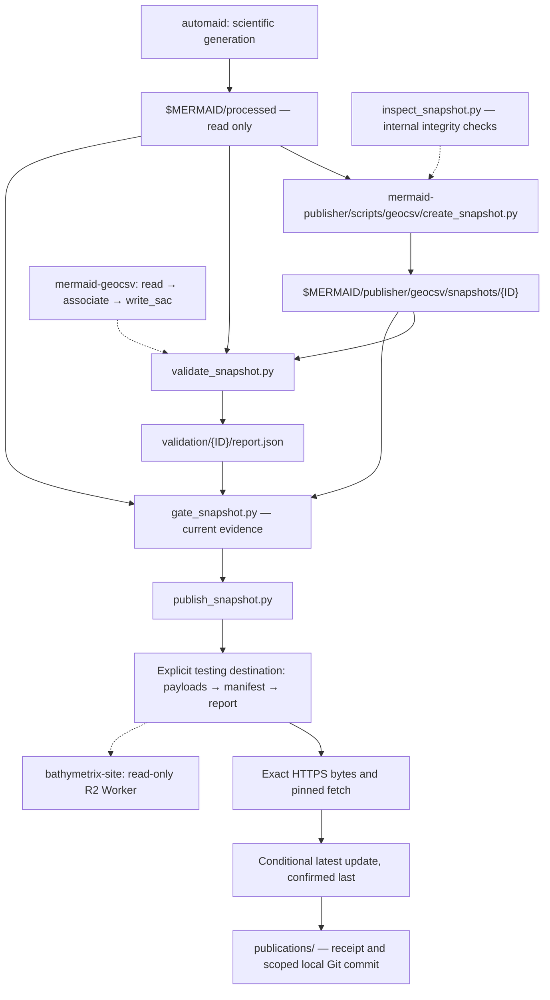

# GeoCSV publication workflow

The publisher owns snapshot creation, full-archive validation, report schema and
publication gating, transfer, and local archive recording. `mermaid-geocsv`
owns the public scientific APIs. `bathymetrix-site` owns its read-only Worker,
landing page and infrastructure; its hosting runbook remains authoritative for
that deployment. Upstream automaid generates GeoCSV and original waveforms.



## Sources and archive

`$MERMAID/processed` is canonical and protected. Never write to it. A source may
be an ordinary directory. If it is inside a Git working tree, require a clean
entire repository: no staged, unstaged or nonignored untracked changes. Record
full HEAD and the source directory relative to that repository; recheck both
cleanliness and HEAD before/after staging and during validation/gating. Linked
worktrees are supported. Git state does not account for ignored inputs: retain
all existing byte inventories and change checks.

The archive is a separate local Git repository at `$MERMAID/publisher`:

```text
geocsv/
  snapshots/{encoded ID}/       GeoCSV, manifest.json, source_provenance.json
  staging/{encoded ID}/         inventory.json, including recordless exclusions
  validation/{encoded ID}/      exclusive, distinct report attempts
  publications/                successful-publication receipts
```

Retain published products and evidence indefinitely. Back up this archive;
Git history alone is not a backup. No GitHub remote or automatic push is needed.
Original MiniSEED/SAC data and source Git objects are not copied. A full source
commit identifier is recorded, not a Git bundle. Unpublished candidates and
failed evidence remain distinguishable from successful publication receipts;
no cleanup policy is implemented.

Source provenance is local, immutable and bound by report SHA-256. It is not in
the public manifest's GeoCSV files list and is not uploaded. An identical retry
must preserve both manifest and source-provenance bytes. Changed provenance
under the same ID raises. Do not edit frozen manifests or historical reports.

## Commands

Use this checkout's `.venv`. The initial archive has already been initialized
locally during migration; for a new installation initialize it explicitly:

```bash
git init -b main "$MERMAID/publisher"
printf '* -text -filter -ident\n' > "$MERMAID/publisher/.gitattributes"
.venv/bin/python scripts/geocsv/create_snapshot.py \
  --source-root "$MERMAID/processed" \
  --workspace "$MERMAID/publisher/geocsv" \
  --inventory /path/to/reviewed-instruments.csv
```

The reviewed CSV has exactly `instrument_serial,instrument_id` columns. Every
source serial must be accounted for; Station must agree. Recordless sources
are excluded and inventoried. Supply `--previous-manifest` after first publication
to detect unexpectedly missing instruments. Pause upstream processing first.

Using the candidate ID printed by creation, set a task-specific shell variable:

```bash
GEOCSV_CANDIDATE="$MERMAID/publisher/geocsv/snapshots/2026-10-21T22%3A48%3A33.277Z"
GEOCSV_REPORT="$MERMAID/publisher/geocsv/validation/2026-10-21T22%3A48%3A33.277Z/validation-v3.json"
.venv/bin/python scripts/geocsv/validate_snapshot.py \
  --candidate "$GEOCSV_CANDIDATE" --source-root "$MERMAID/processed" \
  --report "$GEOCSV_REPORT"
.venv/bin/python scripts/geocsv/publish_snapshot.py \
  --candidate "$GEOCSV_CANDIDATE" --report "$GEOCSV_REPORT" \
  --source-root "$MERMAID/processed" \
  --base-url https://bathymetrix.com/geocsv/testing/ \
  --object-prefix geocsv/testing --plan
```

`--plan` performs no uploads or commits. With report/source arguments it applies
the scientific gate. Without them it reports publication blocked. Validation
uses bounded batches, strict original-segment association and independent SAC
references. It does not calibrate, merge, repair or copy waveform archives.

An actual publication requires explicit authorization, licensing/citation,
a deployed service, local Git author configuration and SDK credentials resolved
outside the checkout. Replace `--plan` with `--endpoint-url "$GEOCSV_S3_ENDPOINT"`
and `--bucket "$GEOCSV_BUCKET"` only for an authorized operation. Both public
URL and storage prefix are explicit; URL must end in `/testing/` and prefix in
`/testing`. Production activation is currently rejected. The existing R2/S3
transport requires equivalent conditional writes, exact bytes and safe activation
from any alternative endpoint; changing a hostname alone does not establish that.

## Publication and recording

The publisher gates current evidence, uploads immutable payloads, then manifest
and validation.json; verifies exact public bytes and explicitly pinned fetch;
rechecks the gate; then conditionally updates and confirms latest. A lock in the
external workspace serializes operators. A crash leaves the lock for manual
inspection. Never remove a lock without inspecting remote state.

After confirmed publication, write a receipt containing snapshot ID, public URL,
object prefix, manifest/provenance/report/inventory hashes and completion time.
Commit exactly that snapshot, its staging inventory, selected report, receipt
and the archive's `.gitattributes`. The required `* -text -filter -ident` rule
preserves exact Git blob bytes, including CRLF, regardless of automatic newline
conversion settings.
Preserve unrelated staged/unstaged archive work. Identical retries reuse the
existing receipt when the same release was already selected; later activations
create new events. Never push automatically.

Remote publication and local Git recording are separate transactions. A local
recording failure exits 2 with `published; local recording incomplete`. Its
receipt supports network-free recovery:

```bash
.venv/bin/python scripts/geocsv/publish_snapshot.py \
  --record-only "$MERMAID/publisher/geocsv/publications/RECEIPT.json"
```

Recovery checks archived artifact hashes and commits the existing event; it does
not revalidate against a subsequently changed live source or republish remotely.
Ordinary prepublication failures exit 1. An ambiguous activation/HTTP failure
exits 2 with an unconfirmed-outcome message and requires inspecting remote state
before retrying. Identical immutable retries
reuse objects; conflicts never overwrite them.

## Status and verification

Publisher 0.1.0/report schema 3 preserve scientific comparison rules from the
website's schema-2 workflow. Historical 43,365-pair acceptance is retained as
historical evidence, not reused. Fresh schema-3 complete-corpus validation is
required for a new candidate. Scientific acceptance, deployment and test uploads
do not authorize production promotion or a first formal release.

Offline tests cover scientific comparisons, changed inputs/evidence, clean Git
sources, source tracking/revision changes, dedicated Git archives, publication
sequencing, testing isolation and recording recovery. CI exercises frozen and
current consumers separately. Real R2/SDK behavior, deployed cache controls,
complete hosted downloads, licensing/citation and DNSSEC restoration remain
pending. No live upload, deployment, full-archive rerun or source modification
is performed by the migration.
