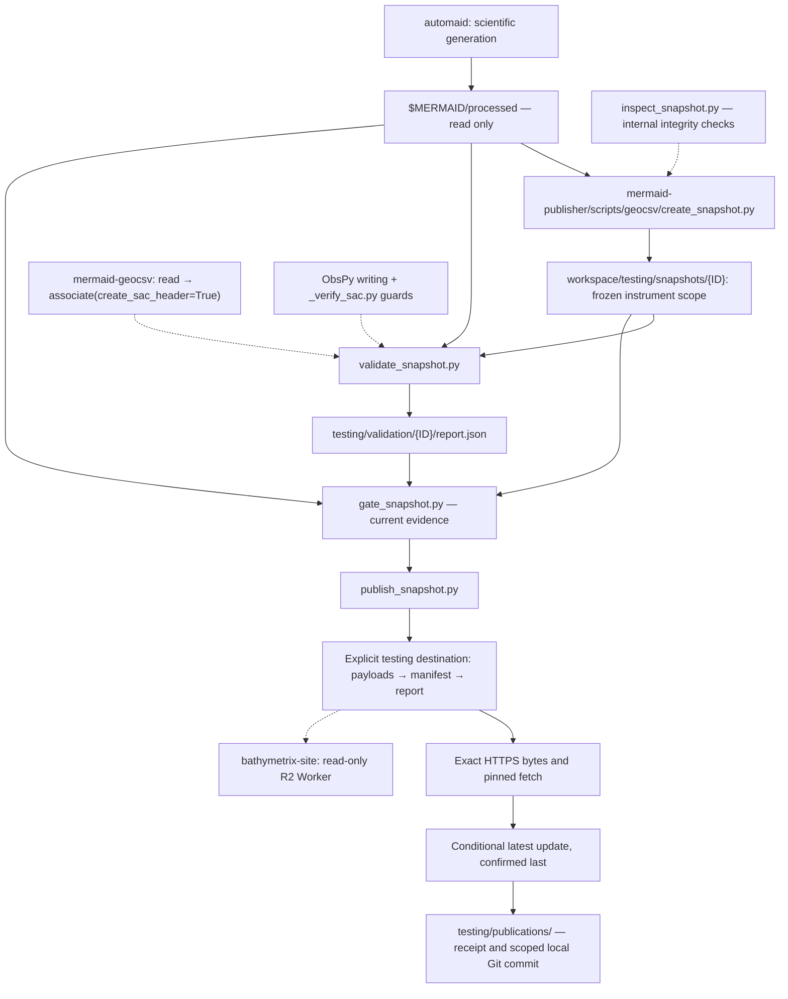

# Current local schema workflow

Publisher 0.4.0 requires the migrated consumer >= 0.27.0. Install the adjacent
local checkout as described in the README. Use create and validate for isolated
`testing_only: true` candidates. Report schema 4 uses `recording_records` and
retains all scientific limits. Existing hosted bytes remain old-format; use a
local test server for new-format fetch/read verification. No publication is
authorized by local acceptance. Historical deployment observations below retain their original software and data provenance.

# GeoCSV publication workflow

The publisher owns snapshot creation, full-archive validation, report schema and
publication gating, transfer, and local archive recording. `mermaid-geocsv`
owns the public scientific APIs. `bathymetrix-site` owns its read-only Worker,
landing page and infrastructure; its hosting runbook remains authoritative for
that deployment. Upstream automaid generates GeoCSV and original waveforms.



Current consumers supply fresh SAC station location headers at association;
ObsPy supplies writing and the publisher verifies final-waveform consistency,
storage and round trips. Historical consumer/exporter compatibility is removed. See the
[SAC verification inventory](sac-verification.md).

## Sources and archive

Only MERMAID GeoCSV schema 1.0.0 is accepted. Creation and candidate inspection
require its exact first-line declaration and literal six-digit UTC `#created`
declaration, including recordless sources. Duplicate schema declarations and
comments after the column header raise; quoted multiline values remain data.
Creation performs an identity preflight, not full payload validation: the
consumer's parser and exhaustive scientific checks must pass before publication.

`$MERMAID/processed` is canonical and protected. Never write to it. A source may
be an ordinary directory. If it is inside a Git working tree, require a clean
entire repository: no staged, unstaged or nonignored untracked changes. Record
full HEAD and the source directory relative to that repository; recheck both
cleanliness and HEAD before/after staging and during validation/gating. Linked
worktrees are supported. Git state does not account for ignored inputs: retain
all existing byte inventories and change checks.

Creation and validation accept ordinary local workspaces, including temporary
directories, without Git or an archive. They do not upload, commit or imply
publication intent. For actual publication, the workspace must be the `geocsv/`
directory in a dedicated persistent Git archive. The canonical archive is
`$MERMAID/publisher`:

```text
geocsv/
  testing/
    snapshots/{release component}/   GeoCSV, manifest.json, source_provenance.json
    staging/{release component}/     inventory.json, including recordless exclusions
    validation/{release component}/  exclusive, distinct report attempts
    publications/              successful-publication receipts
```

Retain production products and evidence indefinitely. Initial workflow-testing
snapshots may be retired after verification through an explicitly authorized
cleanup; they are not permanent scientific releases. Their bytes remain immutable
until retirement, and retired testing identities cannot be reused for different
bytes. Cleanup must account for testing objects/pointers, caches and local
artifacts; deleting working-tree files alone does not remove their Git history.
Do not delete or rewrite anything without that separate authorization.
Back up the archive while it is retained; Git history alone is not a backup.
No GitHub remote or automatic push is needed.
Original MiniSEED/SAC data and source Git objects are not copied. A full source
commit identifier is recorded, not a Git bundle. Unpublished candidates and
failed evidence remain distinguishable from successful publication receipts;
no automatic cleanup is implemented.

Remote testing URLs use `/geocsv/testing/` and R2 keys use `geocsv/testing/`.
The creator derives the local `testing/` namespace from the manifest’s
`testing_only: true` flag. `--workspace` remains the base directory (`geocsv/`
for the archive); do not append `testing/` to that argument. Staging, validation,
publication receipts and the publication lock share the testing collection.
Production manifests remain unsupported. Retirement is an operator procedure;
there is no deletion command in the publisher.

The earlier testing-namespace migration required an explicit move of each testing
snapshot and its staging/validation evidence into `testing/`. Frozen files must
remain byte-identical; old paths are rejected. Layout changes do not alter public
URLs, object keys, manifest/report schemas or scientific limits for that migration.
The separate 2026-10-28 hyphenated-path change does update URLs and object keys;
see [its review](release-path-review.md). Reports bind
publisher code, so retain old reports and produce fresh evidence after code
changes. No automatic migration or publication occurs.

Source provenance is local, immutable and bound by report SHA-256. It is not in
the public manifest's GeoCSV files list and is not uploaded. An identical retry
must preserve both manifest and source-provenance bytes. Changed provenance
under the same ID raises. Do not edit frozen manifests or historical reports.

## Commands

### Local validation without publication

Use an ordinary temporary workspace for a full-corpus check:

```bash
GEOCSV_CHECK_WORKSPACE="$(mktemp -d)"
.venv/bin/python scripts/geocsv/create_snapshot.py \
  --source-root "$MERMAID/processed" \
  --workspace "$GEOCSV_CHECK_WORKSPACE" \
  --inventory /path/to/reviewed-instruments.csv
```

Use the candidate path printed by creation with `validate_snapshot.py` and put
`--report` outside the frozen candidate, for example under
`$GEOCSV_CHECK_WORKSPACE/testing/validation/`. Omit `--instruments` for the full
corpus; add `--instruments P0006 P0045` to check only that batch. No Git initialization,
archive copying or publication is required. Disposable check products may be
removed when no longer needed; published artifacts retain their archival policy.

### Publication candidate

Use this checkout's `.venv`. The initial archive has already been initialized
locally during migration; for a new installation initialize it explicitly:

```bash
git init -b main "$MERMAID/publisher"
printf '* -text -filter -ident\n' > "$MERMAID/publisher/.gitattributes"
.venv/bin/python scripts/geocsv/create_snapshot.py \
  --source-root "$MERMAID/processed" \
  --workspace "$MERMAID/publisher/geocsv" \
  --inventory /path/to/reviewed-instruments.csv \
  --instruments P0006 P0045
```

The reviewed CSV has exactly `instrument_serial,instrument_id` columns. Every
source serial must be accounted for even with an explicit selection; Station
must agree for in-scope instruments. Selection happens only at creation and
is immutable. Unknown or duplicate IDs raise. Recordless sources in scope
are excluded and inventoried. Supply `--previous-manifest` after first publication
to detect unexpectedly missing instruments. Pause upstream processing first.

Create, validate and publish use the same frozen manifest. Publishing has no
instrument-selection switch. The P0006/P0045 publication candidate needs its own
fresh report even after a separate full-corpus check passes. The archive retains
only that candidate's payloads and evidence. Unselected payloads and original
waveform archives are not copied into it.

Within one local or hosted collection, a timestamp identifies exactly one
immutable inventory. Changing selection under an existing timestamp raises;
use separate local workspaces for different check batches. Expanding an already
hosted inventory requires a new upstream timestamp, not an edited manifest.

Using the candidate ID printed by creation, set a task-specific shell variable:

```bash
GEOCSV_CANDIDATE="$MERMAID/publisher/geocsv/testing/snapshots/2026-10-30T18-08-32.316000Z"
GEOCSV_REPORT="$MERMAID/publisher/geocsv/testing/validation/2026-10-30T18-08-32.316000Z/validation-new-attempt.json"
.venv/bin/python scripts/geocsv/validate_snapshot.py \
  --candidate "$GEOCSV_CANDIDATE" --source-root "$MERMAID/processed" \
  --report "$GEOCSV_REPORT"
.venv/bin/python scripts/geocsv/publish_snapshot.py \
  --candidate "$GEOCSV_CANDIDATE" --report "$GEOCSV_REPORT" \
  --source-root "$MERMAID/processed" \
  --base-url https://bathymetrix.com/geocsv/testing/ \
  --object-prefix geocsv/testing --plan
```

`--plan` performs no uploads or commits. With report/source arguments it applies
the scientific gate. Without them it reports publication blocked. Validation
uses bounded batches, strict original-segment association and independent SAC
references. It does not calibrate, merge, repair or copy waveform archives.

An actual publication requires explicit testing-upload authorization, approved
data licensing and any required citation, a deployed service, local Git author
configuration, and SDK credentials resolved outside the checkout. Replace
`--plan` with `--endpoint-url "$GEOCSV_S3_ENDPOINT"`
and `--bucket "$GEOCSV_BUCKET"` only for an authorized operation. Both public
URL and storage prefix are explicit; URL must end in `/testing/` and prefix in
`/testing`. Production activation is currently rejected. The existing R2/S3
transport requires equivalent conditional writes, exact bytes and safe activation
from any alternative endpoint; changing a hostname alone does not establish that.

### Local revalidation after a consumer update

An existing published candidate can be revalidated locally without recreating
it or changing its hosted evidence. Inspect the actual consumer revision and
public imports, verify schema 1.0.0 support and the freshly installed consumer
before running validation. Retain previous reports unchanged: the acceptance
gate rejects reports whose software fingerprints differ from the current
installation, even when the package version is unchanged.

Use the existing candidate and read-only source with `validate_snapshot.py`;
select a distinct, unused `--report` filename in that candidate's validation
directory. The report is created exclusively. Validate the complete frozen
instrument scope, then run `publish_snapshot.py --plan` with that new report
and the explicit testing destination, as above. Neither command needs storage
credentials for this local check. Do not run creation, expand the instrument
scope or rerun a separate full-corpus snapshot for this operation.

A passing local gate establishes scientific acceptance under the current
software. It does not replace the already published immutable `validation.json`
or authorize uploads, pointer changes or a publication retry with different
report bytes. Keep the new local evidence distinct from the report used for
the original publication.

## Hyphenated paths and testing replacement

Publisher 0.3.0 creates new snapshot/staging directories and R2 keys using
`release_id.replace(":", "-")`. New validation directories use that same
component. Manifest `release_id`, GeoCSV `#created`, provenance, arbitrary
record timestamps and exact payload bytes are unchanged. All fractional digits
are retained. Existing encoded local archive directories and receipts remain historical
evidence; active candidate inspection, creation and receipt recovery reject
encoded paths rather than reading them as aliases.
The operator does not rename or rewrite historical evidence.

Publication requires mermaid-geocsv >= 0.27.0 and new schema 1.0.0 payloads.
Before release, install the adjacent local checkout with the requirements in the
README. Reports bind the installed consumer's exact code and version. Old
consumers are rejected before object writes. The historical
[compatibility review](release-path-review.md) records the path protocol.

The historical 2026-10-28 replacement was authorized for the existing P0006/P0045 testing
scope. Preserve original data/manifest bytes, create fresh scientific evidence,
verify the new objects and pinned fetch before selecting latest, and retire
only the prior testing release objects after replacement verification. Old
testing URLs can end; no legacy serving aliases are promised. Cached old URLs
are rejected by the updated Worker before cache lookup. Local historical
archive evidence is retained. Production is outside this operation.

### Recorded public testing destination

| Setting | Value |
| --- | --- |
| Collection URL | `https://bathymetrix.com/geocsv/testing/` |
| Object prefix | `geocsv/testing` |
| Worker name | `bathymetrix-geocsv` |
| Worker route | `bathymetrix.com/geocsv/*` |
| Bucket binding | `GEOCSV` |
| SDK profile name | `mermaid-geocsv-testing` |

These public service identifiers and the local profile name are retained here
for later operations. The account-specific S3 endpoint, private bucket/account
configuration and credentials stay outside the public checkout. Resolve
credentials through the SDK provider; never print or copy them.

### Publication configuration

`MERMAID_PUBLISHER_CONFIG` optionally names a private JSON settings file outside
software checkouts and the publication archive. Explicit CLI destination options
override file settings. When the variable is unset or empty, supply the existing
CLI options. A configured file that cannot be read or has invalid settings blocks
the operation; settings are not printed in configuration errors.

| JSON key | Publication setting |
| --- | --- |
| `profile` | Named SDK profile; omitted uses the SDK's normal profile selection |
| `endpoint_url` | `--endpoint-url` |
| `bucket` | `--bucket` |
| `base_url` | `--base-url` |
| `object_prefix` | `--object-prefix` |

Only these keys are supported, each with a nonempty string value when present.
Credentials remain with the SDK provider and must not be stored in this file.
Treat the file as JSON, not shell code. `--plan` loads destination settings but
performs no storage authentication or writes. `--record-only` does not load the
file. Configuration does not authorize publication; all scientific and explicit
authorization gates still apply.

## Publication and recording

The publisher gates current evidence, uploads immutable payloads, then manifest
and validation.json; verifies exact public bytes and explicitly pinned fetch;
rechecks the gate; then conditionally updates and confirms latest. A lock in the
external workspace serializes operators. A crash leaves the lock for manual
inspection. Never remove a lock without inspecting remote state.

After confirmed publication, write a receipt containing snapshot ID, public URL,
object prefix, manifest/provenance/report/inventory hashes and completion time.
Commit exactly that snapshot, its staging inventory, selected report, receipt
and the archive's `.gitattributes`. The required `* -text -filter -ident` rule
preserves exact Git blob bytes, including CRLF, regardless of automatic newline
conversion settings.
Preserve unrelated staged/unstaged archive work. Identical retries reuse the
existing receipt when the same release was already selected; later activations
create new events. Never push automatically.

Remote publication and local Git recording are separate transactions. A local
recording failure exits 2 with `published; local recording incomplete`. Its
receipt supports network-free recovery:

```bash
.venv/bin/python scripts/geocsv/publish_snapshot.py \
  --record-only "$MERMAID/publisher/geocsv/testing/publications/RECEIPT.json"
```

Recovery checks archived artifact hashes and commits the existing event; it does
not revalidate against a subsequently changed live source or republish remotely.
Ordinary prepublication failures exit 1. An ambiguous activation/HTTP failure
exits 2 with an unconfirmed-outcome message and requires inspecting remote state
before retrying. Identical immutable retries
reuse objects; conflicts never overwrite them.

## Status and verification

Testing latest selects the schema 1.0.0 P0006/P0045 snapshot
`2026-10-30T18:08:32.316000Z`, published on 2026-10-30 after fresh report-4
acceptance of 3,292 pairs. Exact public bytes, fetch/read/associate, production
isolation and scoped archive recording passed; see [publication findings](schema1-testing-publication.md).

Publisher 0.3.0/report schema 3 preserve scientific comparison rules from the
website's schema-2 workflow. Historical 43,365-pair acceptance is retained as
historical evidence, not reused. Fresh schema-3 validation of every original pair
in the frozen instrument scope is required for each candidate. Scientific
acceptance, deployment and test uploads
do not authorize production promotion or a first formal release.

Offline tests cover scientific comparisons, changed inputs/evidence, clean Git
sources, source tracking/revision changes, dedicated Git archives, publication
sequencing, testing isolation and recording recovery. CI exercises frozen and
current consumers separately. The initial P0006/P0045 testing snapshot was
explicitly authorized and published on 2026-10-26. Live R2 conditional-write
rejection, exact HTTPS bytes, cache hits and controls, latest/pinned fetch,
one/all instruments, memory/disk, local reuse and download provenance passed.
A complete read/associate/write_sac rerun using hosted downloads passed all
3,292 original waveform pairs. The receipt and scoped commit are in the local
archive. See the [publication findings](schema3-findings.md#initial-hosted-testing-publication--2026-10-26).
DNSSEC restoration and post-activation DNS, HTTPS/download and email checks
subsequently passed on 2026-10-26; see the
[restoration findings](infrastructure-plan.md#dnssec-restoration--2026-10-26).
The authorized 2026-10-28 path replacement subsequently passed fresh scientific
acceptance and hosted verification, with the same data/manifest bytes and the
new consumer. Its previous testing objects/URLs were retired; see the
[path review](release-path-review.md). Full-corpus licensing, further uploads
and production activation remain separate outstanding decisions. Canonical source inputs were not modified.
